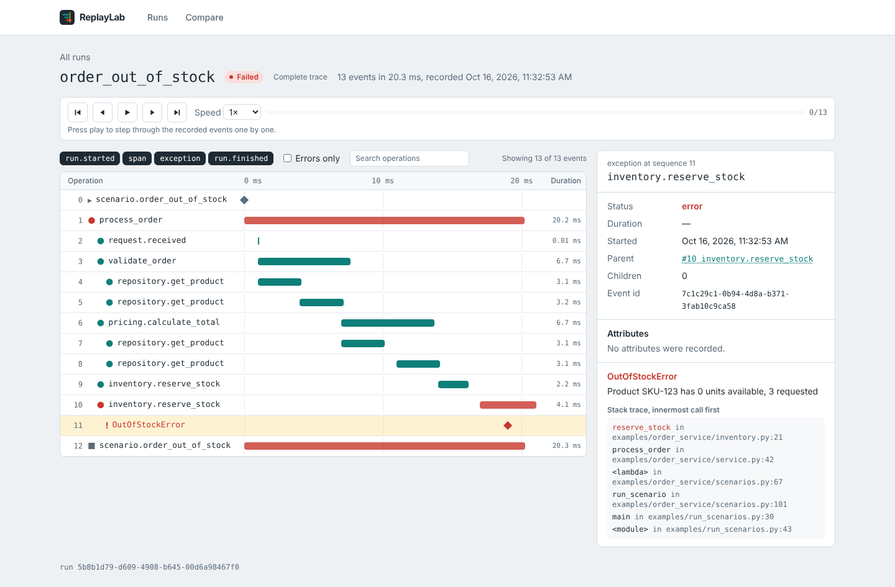
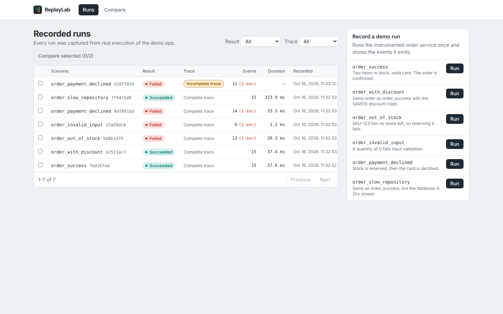
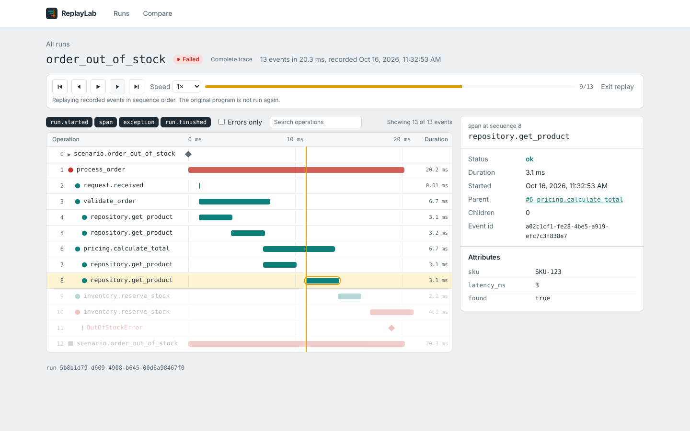
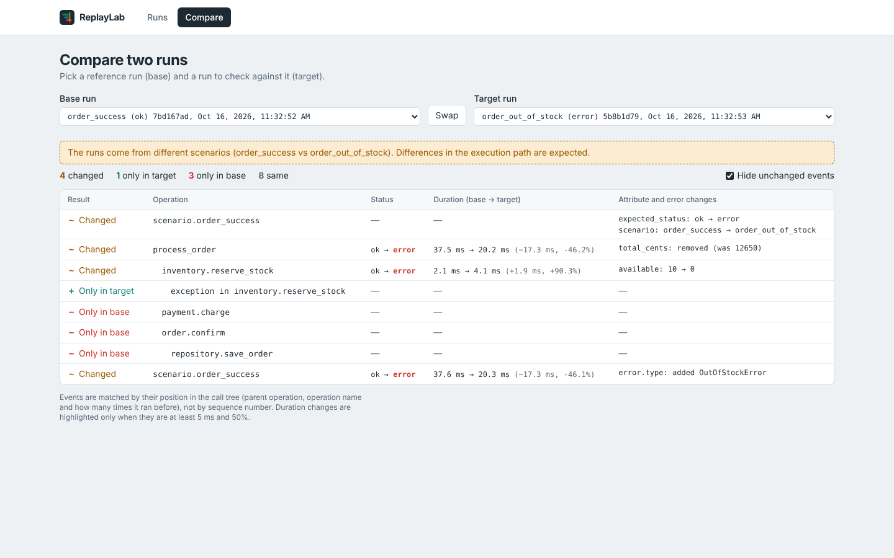
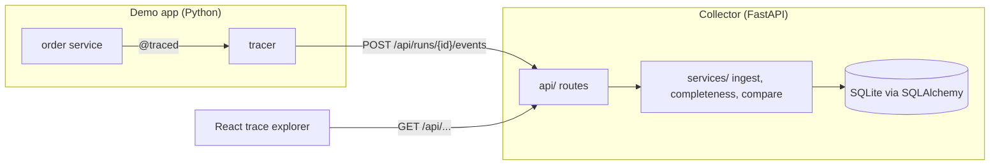
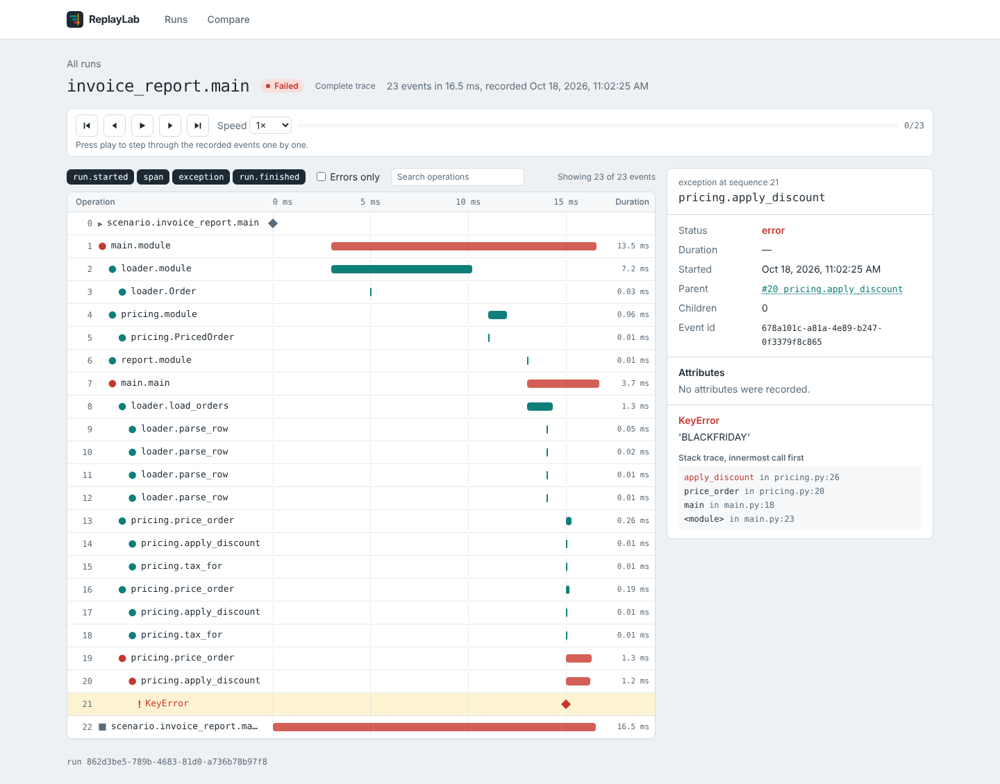

# ReplayLab

ReplayLab records what a Python program actually did while it ran, then lets you explore, replay and compare those recordings in the browser.



## The problem

When a request fails, a stack trace tells you **where** it crashed, not **what happened before**. Which steps ran? How long did each one take? What values did they see? How does this failing run differ from one that worked?

ReplayLab answers those questions for a small instrumented demo service:

1. The demo app is instrumented with a `@traced` decorator. Every important operation becomes a recorded **event**.
2. A FastAPI **collector** validates the events and stores them in SQLite.
3. A React **trace explorer** shows the timeline, the details of each event, a step-by-step replay, and a diff between two runs.

> **Replay is not re-execution.** ReplayLab replays the *recorded events* in order. It never runs the original code again and never executes code submitted by a user.

## Features

| Feature | What it does |
|---------|--------------|
| Real event collection | A decorator and context manager record spans, durations, attributes and exceptions while the demo app runs |
| Trace any script | `python -m tracer run your_script.py` records every function call of an ordinary Python project, with **no code changes** (uses `sys.monitoring`) |
| Validated ingestion | Every event is checked against a documented schema. Bad batches are rejected as a whole (all or nothing) |
| Trace completeness | Each run is checked for a missing start or finish, sequence gaps, and missing parents. Incomplete traces are clearly flagged, never shown as complete |
| Trace explorer | Run list with filters and pagination, a timeline waterfall, event filters, and an event inspector with a stack trace |
| Recorded replay | Play, pause, step forward and back, speed control, a playhead and progress bar |
| Run comparison | Deterministic diff: added, missing and changed events, with status, attribute, error and duration changes |
| Sanitization | Sensitive attribute keys (`password`, `token`, `card`…) are redacted twice, by the tracer and again by the collector |

| Recorded runs | Replay | Comparison |
|---|---|---|
|  |  |  |

## Architecture



An event goes on this journey:

1. `inventory.reserve_stock()` runs inside `@traced`. When it starts, it takes the next **sequence number**. When it finishes, it becomes a `span` event with its duration and status.
2. At the end of the run, the tracer sends all events in one batch.
3. Pydantic validates every event. The ingest service stores them in one transaction and recomputes the run summary (status, completeness).
4. The frontend loads the run and its events, **ordered by sequence**, and draws the timeline.

More detail: [docs/architecture.md](docs/architecture.md). The event contract: [docs/event-schema.md](docs/event-schema.md).

## Technology stack

- **Backend:** Python 3.12, FastAPI, Pydantic v2, SQLAlchemy 2, SQLite
- **Instrumentation:** a small custom tracer (decorator, context manager and `contextvars`) plus automatic tracing with `sys.monitoring`. No external packages
- **Frontend:** React 19, TypeScript, Vite, Tailwind CSS v4, React Router
- **Tests:** pytest (111 tests), Vitest and React Testing Library (38 tests)
- **Delivery:** Docker, Docker Compose, nginx

## Running it locally (Windows PowerShell)

Requirements: Python 3.11 or newer (3.12 recommended), Node.js 24 LTS (22.22.2+ also works), Git.

**1. Backend (terminal 1)**

```powershell
cd backend
python -m venv .venv
.venv\Scripts\Activate.ps1          # if blocked: Set-ExecutionPolicy -Scope CurrentUser RemoteSigned
pip install -r requirements-dev.txt
uvicorn app.main:app --reload
```

The API runs at http://localhost:8000. Interactive API docs are at http://localhost:8000/docs.

**2. Frontend (terminal 2)**

```powershell
cd frontend
npm install
npm run dev
```

Open http://localhost:5173. Vite forwards `/api` requests to the backend.

**3. Record some runs.** Click **Run** next to a scenario in the UI, or send every scenario over HTTP from a third terminal:

```powershell
cd backend
.venv\Scripts\Activate.ps1
python -m examples.run_scenarios
```

```
[ OK ] order_success            run=3c7e8ea1-...  events=15  status=ok     trace=complete
[ OK ] order_out_of_stock       run=019ffc0c-...  events=13  status=error  trace=complete
...
```

### With Docker

```powershell
docker compose up --build
```

Then open http://localhost:8080. Runs are kept in the `replaylab-data` volume.

## Trace any Python script (no code changes)

```powershell
cd backend
.venv\Scripts\Activate.ps1
python -m tracer run ..\samples\invoice_report\main.py
python -m tracer run ..\samples\invoice_report\main.py -- ..\samples\invoice_report\data\orders_bad.csv
python -m tracer run C:\path\to\your_project\main.py --root C:\path\to\your_project
```

Everything after `--` is passed to your script. Every function defined under `--root` (default: the script's folder) becomes a span. The standard library, installed packages and virtual environments are skipped. Function arguments and local variables are **never** recorded, only the function name, the file and line where it is defined, the duration, the status and any exception. Requires Python 3.12+.

| Option | Meaning |
|--------|---------|
| `--root DIR` | Project folder to record (default: the script's folder) |
| `--name NAME` | Run name in the UI (default: `folder.script`) |
| `--max-spans N` | Stop recording after N calls (default 5000). Extra calls are counted in `replaylab.dropped_spans` |
| `--save FILE` | Also write the events to a JSON file |
| `--no-send` | Do not send to the collector |



## Demo scenarios

| Scenario | What happens | Good for |
|----------|--------------|----------|
| `order_success` | Order confirmed | Baseline |
| `order_with_discount` | Same order with `SAVE10` | Attribute diff (`total_cents`, `discount_percent`) |
| `order_out_of_stock` | Second stock reservation fails | Exception inspection, missing events in a diff |
| `order_invalid_input` | Quantity 0 fails validation | Early failure |
| `order_payment_declined` | Stock reserved, then card declined | Failure late in the flow |
| `order_slow_repository` | Database 20× slower | Duration diff |

Try comparing `order_success` with `order_out_of_stock`, then with `order_slow_repository`.

## API overview

| Method | Path | Purpose |
|--------|------|---------|
| `POST` | `/api/runs/{run_id}/events` | Store a batch of events (1–1000). `201`, or `409` on a conflict, `422` if invalid |
| `GET` | `/api/runs?status=&completeness=&limit=&offset=` | List runs, newest first |
| `GET` | `/api/runs/{run_id}` | Run summary with completeness issues |
| `GET` | `/api/runs/{run_id}/events?event_type=&status=&limit=&offset=` | Events, always ordered by sequence |
| `GET` | `/api/compare?base=&target=` | Diff two runs |
| `GET` | `/api/scenarios` | List demo scenarios |
| `POST` | `/api/scenarios/{name}/runs` | Run a predefined scenario and store its events |
| `GET` | `/api/health` | Health check |

Every error uses one shape: `{"error": {"code": "not_found", "message": "...", "details": null}}`.

## Testing

```powershell
cd backend;  pytest          # 111 tests: schema, tracer, auto tracer, scenarios, completeness, API, comparison, end-to-end HTTP
cd frontend; npm test        # 38 tests: replay state machine, timeline layout, tree, inspector, pages and UI states
```

The backend end-to-end test starts a real uvicorn server, runs the demo app as an HTTP client against it, and reads the runs back.

## Design decisions

- **One event per finished operation (span model).** Half as many events as separate start and end events, and simpler to diff. Trade-off: an operation interrupted by a crash is lost, but then `run.finished` is also missing, so the run is marked incomplete.
- **`sequence` decides order, not timestamps.** Children finish (and are sent) before their parents, wall clocks can jump, and two events can share a millisecond. Durations use a monotonic clock (`perf_counter`).
- **Exceptions are separate events, stored once** on the span where they were raised. Parent spans only get `status: "error"`.
- **"Complete" and "successful" are separate ideas.** A crashed run can still have a complete trace. A run with missing events is never presented as complete.
- **Idempotent ingest.** Re-sending the same events is safe. Two *different* events with the same id or sequence number are a conflict (`409`).
- **Comparison matches events by call path**, not by sequence number, so one extra call does not shift every later match.
- **Explicit attributes only.** Local variables are never captured automatically.
- **Modular monolith.** One backend process with clear layers (`api` → `services` → `models`/`storage`). No message queue or microservices.

## Limitations

- The tracer supports synchronous code only (no `async`), one run at a time per context. Automatic tracing skips generators and async functions and records only the main thread.
- Within loops, comparison matches iterations by position. If a run skips the *first* iteration, later iterations get compared with the wrong partner.
- Tables are created with `create_all`. A changing schema would need migrations (Alembic).
- SQLite fits one machine and modest volume. It is not built for many concurrent writers.
- `error.message` is free text and is not redacted automatically.
- The Docker setup was written but not yet run end to end on a clean machine.

## Future improvements

- An optional AI debugging assistant that explains a failure using **only** recorded evidence, clearly separating facts from hypotheses
- `async` support in the tracer
- PostgreSQL and Alembic migrations
- Sending events in chunks during long runs, and streaming new runs to the UI
- OpenTelemetry export
